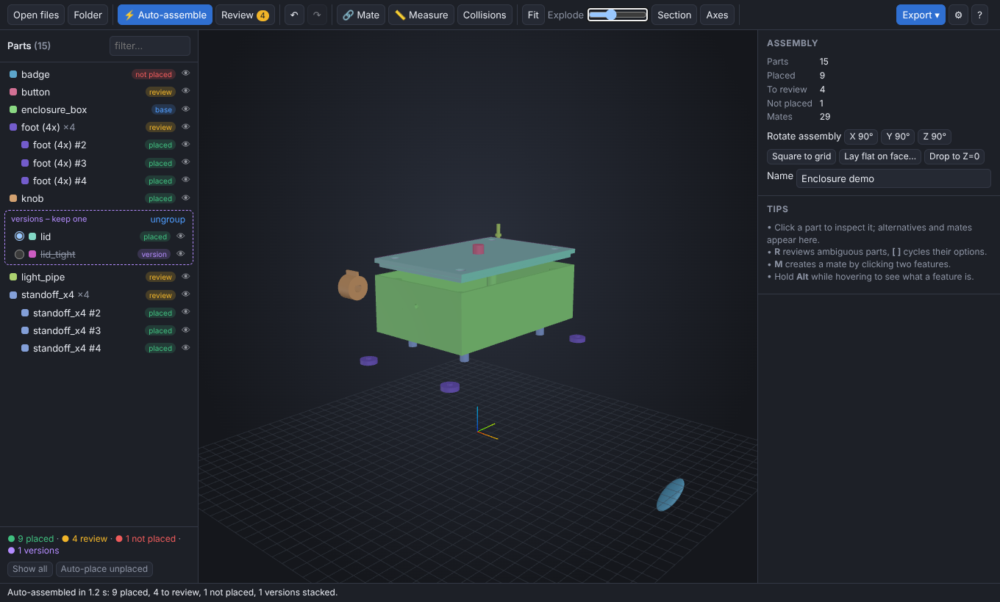
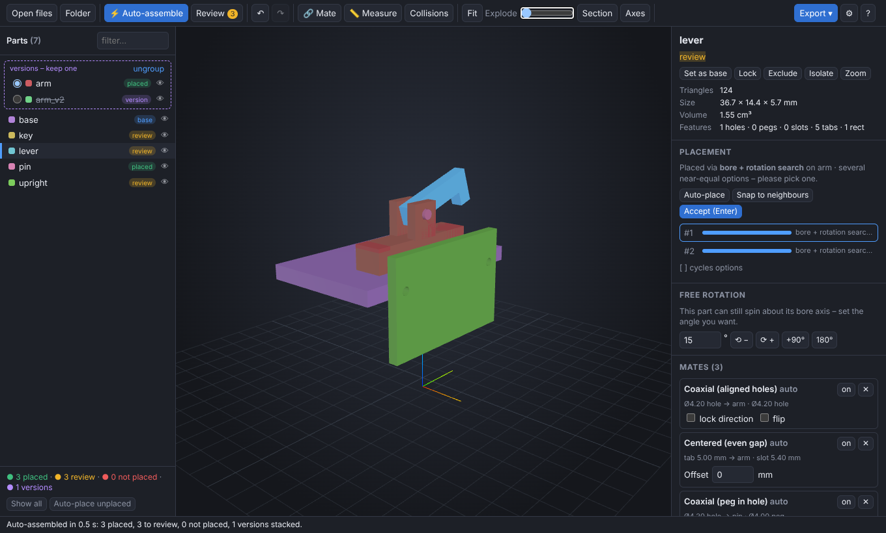

# STL Assembler

Drag-and-drop a whole kit of STL parts, laid flat for printing, and get one assembled model back. The tool finds bores, pegs, slots, tabs, rectangular keys and matching split faces on every part, works out how the parts fit together, and exports **one STL file with every part as a separate body** (or a 3MF). It is built for the case where the next tool in your chain, such as MatterHackers' Goop *Filament Paint Match*, a slicer or a renderer, needs the assembled model.

It is a CAD-style assembly workflow made for STLs, where most CAD tools are painful.



## Use it on your Mac (Intel or Apple silicon)

There is nothing to install.

1. Download **[`dist/STL-Assembler.html`](dist/STL-Assembler.html)**: open it on GitHub, click *Download raw file*, and save it anywhere, e.g. your Desktop.
2. Double-click it. It opens in your default browser. **Chrome** is the fastest; Safari 15+, Edge and Firefox also work.
3. Drag a folder, a `.zip` you downloaded from Printables or Thingiverse, or a handful of `.stl`/`.obj`/`.3mf` files onto the window.

Everything runs locally in the browser. Your files are never uploaded, and the app works offline. Click **Load demo kit** on the start screen to try it without your own files.

## Workflow

1. **Drop the files.** Each part is analysed in parallel (one worker per CPU core), and part pairs are matched in parallel too. Multi-solid ASCII STLs, multi-object OBJ/3MF files and zipped folders are split into separate parts.
2. **Auto-assemble** runs automatically (`A` re-runs it). The largest part becomes the base. You can pick another with *Set as base*, or *Lock* parts you have already positioned.
3. **Review.** Parts with several plausible poses get a yellow **review** tag. Press `R` to jump to each one. The inspector lists its options:
   - Hover an option to see a ghost preview.
   - Click to apply it, or use `[` and `]` to cycle.
   - Press `Enter` to accept.
   - If none of them is right, press `N` (*None of these*). The part is parked beside the assembly, unmated, for manual placement.
4. **Pick versions.** Near-identical files (e.g. `arm.stl`, `arm_v2.stl`, `lid_tight.stl`) are detected and **stacked in the same place**. Use *Measure*, *Section* or *Isolate* to compare them, then choose which one to keep with the radio button. The others are left out of the export.
5. **Fix anything by hand** (see below).
6. **Export.** Choose *Export → STL (one file, multiple bodies)*.



## What the auto-alignment does

Every part is segmented into surfaces, and these features are detected:

| Feature | Used for |
|---|---|
| **Cylinders**: bores/holes (concave) and pegs/bosses/pins (convex), including partial and D-shaped bores and split half-bores | two bores ↔ two pegs; peg in hole; screw holes lining up across parts (coaxial even across a gap); single bore + rotation search |
| **Holes from face outlines**: every circular opening in a flat face, followed down its wall. This finds small (~2 mm) holes, chamfered or countersunk entries, holes in decimated (`_reduced`) meshes, and **tapered heat-set insert holes (cones)** | the same coaxial matching as cylinders; cones line up with the screw holes on the mating part |
| **Flat faces** with their exact outlines | face contact; split parts glued along a cut (the outlines are matched with 2D ICP); lids sitting on floors; **same-shape faces pressed flat to flat** (a grip scale's back in its debossed pocket) count as strong evidence |
| **Plane pairs**: slots (facing walls) and tabs/ribs/plate thickness (back-to-back walls) | tab centred in a slot with an **even gap** on both sides |
| **Prismatic holes and pegs**: rectangles (two perpendicular slots or tabs), hexagons and octagons | rect or hex key in its socket, at all valid orientations; a complete prism fit counts as strong evidence |

**Axis-aligned kits.** Parts exported from one CAD model usually share the same X/Y/Z axes, rotated only in 90° steps. The tool detects this from the flat faces (⚙ Settings → *Axis-aligned parts*: Auto / Always / Never). It then allows only those 24 square orientations between parts and searches translations driven by bores and same-shape faces, so nothing ends up at a random angle. The assembly also keeps the base part's CAD orientation: use *Flip* or the 90° buttons if it comes out upside down.

**Variants and versions.** Near-identical files (`arm.stl`, `arm_v2.stl`) are stacked onto each other. Different-shaped alternatives for the same spot, such as `Back_Picatinny_V1` and `Back_Picatinny_Full_Length_V1` or two bearing carriages, are each placed in that spot. Both kinds appear as a *keep one* group in the parts list.

For each pair of parts, the matcher generates candidate poses from these correspondences. Any freedom that remains, such as sliding along a pin or turning about a single bore, is resolved by face contacts, slot centring and an angle sweep. Each pose is then scored:

- **Contact.** Surfaces of both parts are sampled against each other's signed distance field. Contact that interlocks in several directions scores higher than one big flat face lying on another.
- **Interpenetration.** Overlapping material counts heavily against a pose, and so do two identical parts in the same spot.
- **Coincident features.** Bores lining up, tabs centred and rect pegs fitting all add to the score, and tighter clearances (0.05–0.3 mm) are preferred.

A global best-first loop then places the most confident part first, re-scoring every remaining option against everything already placed. Ambiguous parts wait until more context exists. Each placed part is **snapped exactly**: the tool infers coaxial, contact, centred and rect mates and solves them with least squares, dropping conflicting mates by priority. You get exact contact and centring instead of approximate poses.

**File names are used as hints.** `pin_x4.stl`, `foot (4x).stl` or `clip 6pcs.stl` get that many copies placed into free matching spots. `_v2`, `rev3`, `copy`, `tight`/`loose` and `(1)` suffixes help group versions. `left`/`right` names are never grouped as versions.

## Manual tools

- **Mate (`M`)** has four tools in its banner:
  - *Two features*: click a bore, peg, face or curved surface on the part to move, then one on the target. The options are coaxial (optionally with locked or flipped direction), contact (faces touch), flush (one plane, facing the same way), parallel and *axis on mid-plane*. If you click a curved surface the tool hadn't recognised, such as a large arc or a curved slot, it fits a cylinder there on the spot.
  - *Mid-plane (4 faces)*: click two parallel faces on the part to move, then two on the target. The two mid-planes are made to coincide: a tab centred in a slot with an even gap, or a part centred on another's width.
  - *Edge to edge*: hover until a straight edge lights up yellow, click it, then click an edge on the target. The edges are made collinear or parallel (for example, a rail edge along the receiver edge).
  - *Mark hole (3 clicks)*: click three points on the rim or wall of a hole the tool missed. It is fitted to the mesh and becomes a normal hole for mates and for later auto-assembly runs (and is saved in project files).

  Every mate can take an **offset in mm**. Mates can be switched off to free a degree of freedom, or deleted.
- **Free angle.** A part held only by one bore and a mid-plane (a lever on a pivot pin) keeps its rotation free. The inspector shows a *Free rotation* control to set any angle, and its mates stay satisfied.
- **Move / rotate.** Move by an exact X/Y/Z offset, rotate by an exact angle, or use the gizmo (`G` move, `T` rotate). Parts mated to a moved part follow it.
- **Auto-place** a single part, **Snap to neighbours** (infer mates with whatever it touches), **+ copy** (add another instance and auto-place it), **Stack as version of…** (register one part onto another).
- **Measure (`D`).** Diameters, face sizes, gaps between parallel faces, axis distances, radial clearance and angles.
- **Section, Explode, Axes, Collisions.** Section clips the view along X, Y or Z to inspect peg engagement. Explode spreads the parts out. Axes shows the detected bore axes (orange = hole, green = peg). Collisions lists every intersecting pair of parts.
- **Assembly orientation.** For axis-aligned kits, the base part's CAD orientation is kept. Otherwise *Square to grid* (done automatically) aligns the main faces with X/Y/Z and puts the biggest face down. *Flip*, *Lay flat on face…* and the 90° rotate buttons adjust it from there.
- **Undo/redo**: `⌘Z` / `⌘⇧Z`.

## Export formats

| Format | Notes |
|---|---|
| **STL – one file, multiple bodies (binary)** | Every part stays a separate closed shell, so slicers (*Split to parts/objects*), Fusion (*Separate*), Blender (*Separate by loose parts*) and similar tools split it back into bodies. |
| **STL – named solids (ASCII)** | One `solid <name> … endsolid` block per part. Bigger file, but the part names are kept. |
| **3MF – separate objects** / **one object, multiple parts** | Names kept. The second mode loads as a single multi-part object in PrusaSlicer, Bambu Studio and OrcaSlicer. |
| **ZIP of STLs** | Each part in its assembled position, as its own file. |
| **Project (.json)** / **project + meshes (.zip)** | Poses, mates, versions and copies. Drop the project file together with the STLs (or just the zip) to continue later. |

*Drop assembly onto Z=0* is on by default. Hidden parts are skipped unless *Include hidden parts* is ticked, and excluded parts and non-kept versions are always left out.

## Keyboard

`A` auto-assemble · `R` review next · `[` `]` cycle options · `Enter` accept · `N` none of these · `M` mate · `D` measure · `F` fit (selected) · `G`/`T` gizmo · `H` hide · `I` isolate · `Del` exclude/include · `Esc` cancel · double-click a part to zoom to it · hold `Alt` while hovering to name a feature.

## Tips for best results

- The detector is tuned for CAD-exported meshes (Fusion, Onshape, SolidWorks, FreeCAD, OpenSCAD, Blender booleans), where bore and face vertices lie exactly on the true surfaces. Sculpted or scanned parts still assemble through flat cut faces and pin holes, but they have fewer features to match.
- If a fit is looser or tighter than the defaults expect, open ⚙ Settings and adjust the contact distance, the peg and slot clearances, or the screw-hole gap.
- Parts with nothing to mate to (stickers, badges, decorative shells) stay **not placed** next to the assembly. Place them with *Mate* or the gizmo.
- If a hole isn't picked up, mark it with *Mate → Mark hole (3 clicks)*. Auto-assembly then uses it too.
- Kits whose parts only connect through hardware that isn't in the files (screws, motors, hotends, bearings) are the hardest case. Expect more parts in *review*, and check them with Section view and Collisions. On the Voron Stealthburner + Clockwork2 STLs (11 parts, about 330k triangles), it takes roughly 10 s: 3 parts are placed confidently, 5 are offered with options, and 3 that only touch through hardware stay unplaced.
- Big parts are fine: a 250k-triangle part analyses in about 9 s on one core, and all parts are analysed in parallel.

## Development

```bash
npm install
```

```bash
npm run build
```

```bash
npm test
```

```bash
npm run test:browser
```

- `npm run build` writes the single-file app `dist/STL-Assembler.html` (`npm run dev` rebuilds on change).
- `npm test` runs the unit tests and the alignment accuracy test on the synthetic kits.
- `npm run test:real` auto-assembles the real nerf blaster kit in `test/real/nerf-blaster` and compares each part with the hand-made reference assembly. The reference's rotations are snapped to 90° steps, since it was aligned by hand. Currently 9 of 14 parts land within 0.6 mm and 2 more within 3 mm. For two of the 3 misses, the correct pose is among the offered options.
- `npm run test:browser` builds the app and runs the headless UI tests (Playwright + Chromium).
- `node test/gen-fixtures.mjs` regenerates the test kits (built with manifold-3d, then laid flat at random orientations).

Source layout:

```
src/core/   geometry engine (no DOM; runs in workers and in Node)
  stl.js threemf.js zip.js   file formats
  mesh.js                    welding, adjacency, mass properties, connectivity
  segment.js fit.js          planar segmentation, cylinder detection, circle fits
  features.js sdf.js         features, slot/tab pairs, rect/hex holes/pegs, samples, signed distance field
  loops.js                   holes and cones from circular openings of flat faces
  pickfit.js                 interactive tools: edge picking, arc fit at a click, 3-point holes
  match.js                   pairwise mating hypotheses and scoring
  assemble.js                versions, global placement, copies, mate inference and snapping
  solver.js                  mate constraint solver (Levenberg–Marquardt) and free-motion analysis
src/app/    browser UI (three.js viewer, worker pool, panels, I/O)
test/       synthetic kits with ground truth, accuracy and browser tests
test/real/  real kits (nerf blaster) with a hand-made reference assembly and benchmark
```

`test/run-tests.mjs` reassembles three synthetic kits (22 files, 28 placements including copies) from random lay-flat orientations and compares every pose with ground truth. Parts that are genuinely ambiguous (symmetric keys, a pin that fits two hole types) pass when the correct pose is among the options offered.
