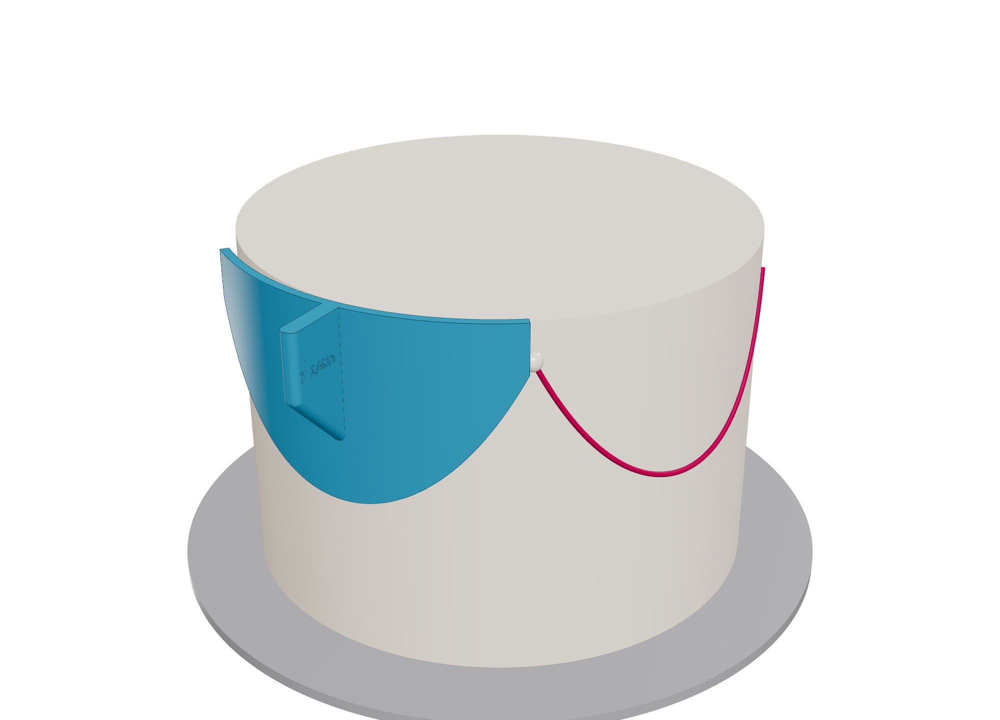
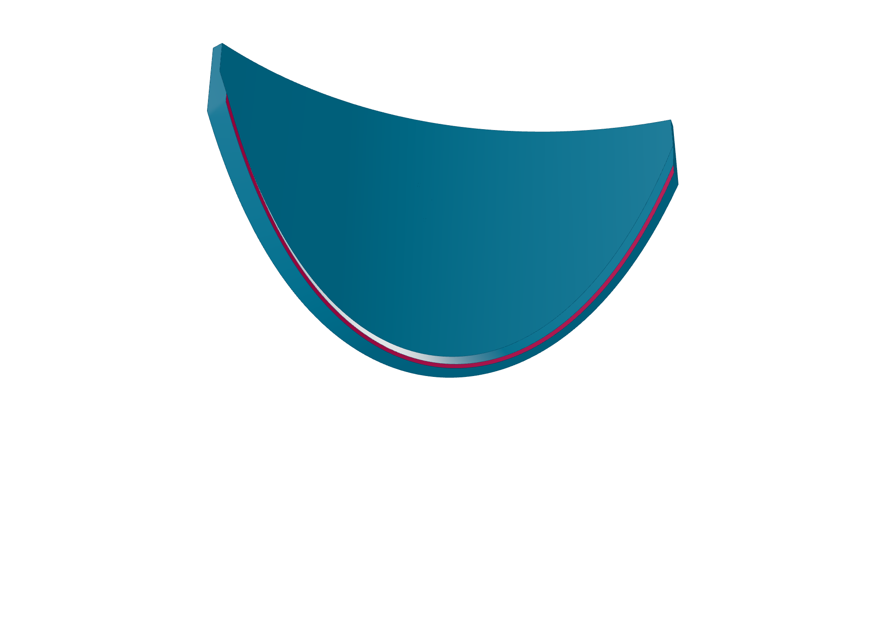
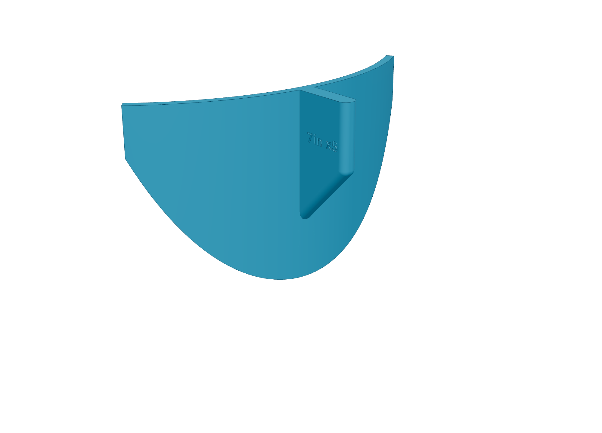
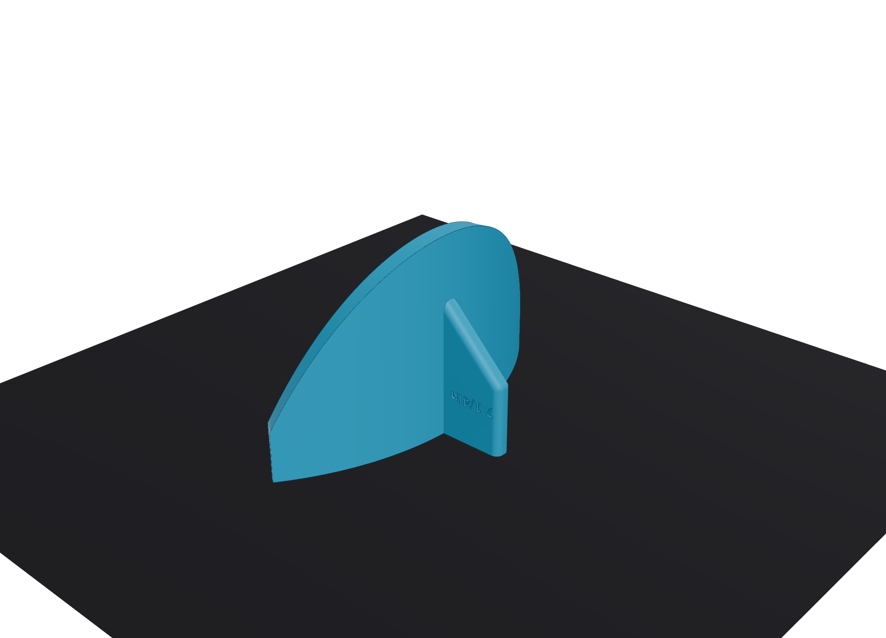
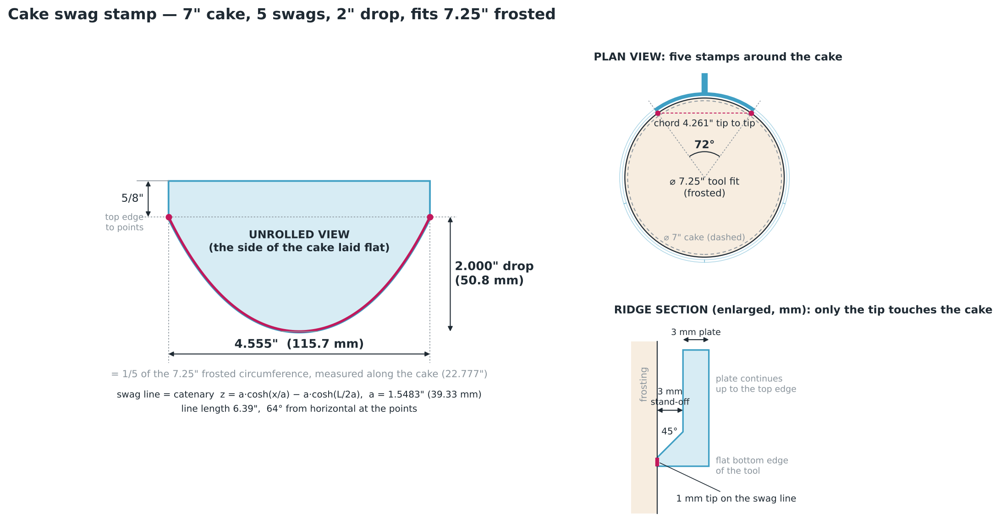

# Cake swag stamp: 7" cake, 5 swags, 2" drop

A 3D-printable stamp that presses one drape (swag) line into the side of a frosted round cake. Use it five times around a 7" cake and the swags meet point to point.



| Cake side (embossing tip in pink) | Back (handle) | Print orientation |
|---|---|---|
|  |  |  |



## Which file to print

The only thing that has to match your cake is the **frosted** diameter. Five stamps only close up if each one covers exactly 1/5 of the frosted circumference, and every extra 1/16" of frosting adds about 0.39" to the circumference.

| File (`models/`) | Frosting per side | Fits frosted Ø | Frosted circumference | Each swag spans (along the cake) |
|---|---|---|---|---|
| `swag_stamp_7in_5swags_2in_drop_7.25in_frosted.stl` (**default**) | 1/8" | 7.25" | 22.78" | 4.555" |
| `swag_stamp_7in_5swags_2in_drop_7.375in_frosted.stl` | 3/16" | 7.375" | 23.17" | 4.634" |
| `swag_stamp_7in_5swags_2in_drop_7.5in_frosted.stl` | 1/4" | 7.5" | 23.56" | 4.712" |

Not sure which one? Wrap a strip of paper around the frosted cake, mark the overlap, and pick the closest circumference in the table. The handle is labelled with both the cake size (`7in x5`) and the fit (`7 1/4in`, and so on).

Each `.stl` is already in print orientation. Each `.step` is the editable CAD solid, with the cake axis along Z, the tool centred on +Y and the swag points at z = 0. Each `.json` lists every computed dimension for that variant.

## The geometry

* **True hanging-cable curve.** The swag line is a catenary, `z = a·cosh(x/a) − a·cosh(L/2a)`. It has a 2.000" sag over the span and meets the next swag at about 64° from horizontal. For the default fit, a = 1.5483" and the line is 6.39" long.
* **Rolled onto the cake, with the arc length preserved.** The curve is laid out on the cake side as if it were flattened. It is then wrapped around the cylinder by arc length (angle = distance / radius), so the span measured *along the cake* stays exactly 1/5 of the circumference (72°).
  * The straight tip-to-tip distance is shorter: 4.261" for the default.
  * A chain hanging on the side of a smooth vertical cylinder takes exactly this rolled catenary shape, so the curve is physically correct as well as looking right.
* **Sized for frosting.** The 4.4" figure (π × 7 / 5 = 4.398") is the arc on the *bare* cake. The marks are made on the frosting, which sits farther out, so the default tool is built for a 7.25" frosted surface and spans 4.555".
  * A tool built to 4.398" would leave a gap of about 0.8" after five stamps on a cake frosted 1/8" thick.
* **Only the tip touches.** A 1.0 mm wide tip on the swag line stands 3 mm proud of the 3 mm backing plate, so the plate never smears the frosting.
  * The tip's lower side is flush with the tool's bottom edge, so you can also trace along that edge.
  * Its upper side is a 45° chamfer, which keeps it strong and printable without supports.
* **Built-in alignment.**
  * The tool ends exactly at the swag points (±36°), and the tip runs right to the end faces.
  * The top edge is 5/8" above the points. Hold the top edge level with the top of the cake and every point lands at the same height.

Checked on the exported meshes: single watertight solid; span ±36.000°; tip within ±0.002 mm of 0.5 mm either side of the catenary along its full length; bottom of the swag line at 2.000"; five copies rotated 72° touch with zero overlap. STEP files re-import as one valid solid.

## Using it

1. Chill the cake until the buttercream has crusted or firmed up.
2. Optionally mark five points evenly around the cake, 5/8" below the top edge. A cake divider or a paper strip folded into fifths works.
3. Hold the handle and press the stamp straight in until the tip leaves a light line, about 1–2 mm deep. Lift it straight off.
4. Put the next stamp's end exactly on the previous swag's end point, keep the top edge level with the cake top, and press. Repeat all the way around.
5. If you end up between sizes, centre each stamp on the pre-marked points instead of chaining end to end. The small error then splits into five tiny steps that hide under the rosette, dot or bow you pipe at each point.

## Printing

* PLA or PETG, 0.2 mm layers, 3 walls, 15–20% infill, **no supports**. A 5 mm brim helps the thin edge stay down.
* The part is about 115 × 46 × 67 mm, at most about 30 g of PLA.
* 3D prints have tiny crevices. Use a food-contact-rated filament, wash before and after use, and don't leave the tool in contact with the frosting longer than needed.

## Making other sizes

`swag_tool.py` generates everything. It needs `pip install cadquery`, plus `trimesh` for the STL clean-up check.

```bash
python3 swag_tool.py                                  # default: 7", 1/8" frosting, 5 swags, 2" drop
python3 swag_tool.py --frosting 0.25                  # thicker frosting
python3 swag_tool.py --cake-diameter 8 --swags 6 --drop 2.5
python3 swag_tool.py --help                           # ridge height, tip width, plate, handle, ...
```
