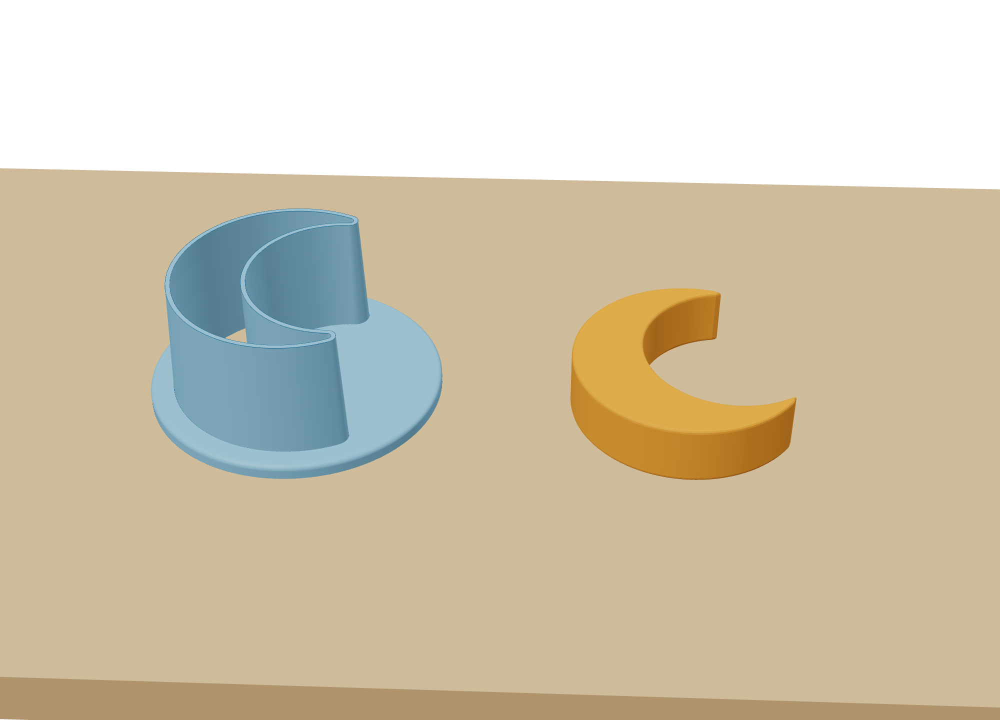
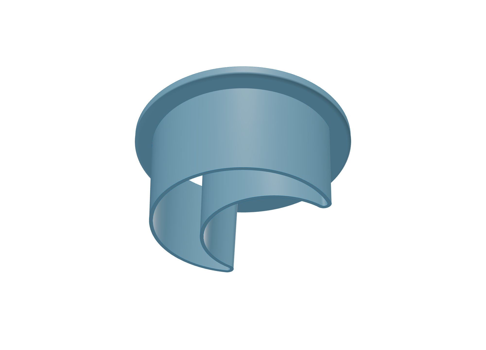
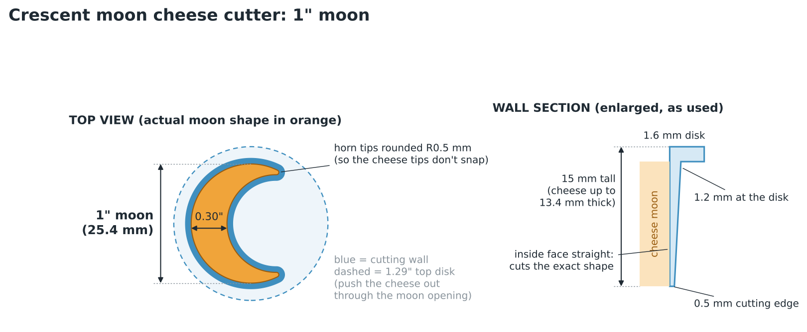

# Crescent moon cheese cutter (1")

A small, thin-walled cutter that punches 1" crescent moons out of sliced cheese.



| Cutting edge (as used) | Dimensions |
|---|---|
|  |  |

## Files (`models/`)

* `crescent_moon_cutter_1in.stl`: print-ready, with the disk flat on the bed and the cutting edge pointing up.
* `crescent_moon_cutter_1in.step`: editable CAD solid.
* `crescent_moon_cutter_1in.json`: every computed dimension.

## Design

* **The moon:** a 1" (25.4 mm) circle with a circle 82% its size, shifted off-centre, taken out of it. The back of the moon is 0.30" (7.6 mm) thick. The horn tips are rounded to R0.5 mm so the cheese tips don't crumble off.
* **Thin cutting wall:** 1.2 mm where it meets the disk, tapering to a **0.5 mm cutting edge**.
  * The inside face is straight up and down, so every piece comes out exactly the moon shape and releases easily.
  * Checked by slicing the solid at several heights: the opening is the same 215.4 mm² moon from top to bottom.
* **Top disk:** 1.29" across and 1.6 mm thick, with a moon-shaped opening.
  * It stiffens the thin wall and gives your finger a flat spot to press.
  * You push the cheese out through the opening.
* **Height:** 15 mm, so it cuts cheese up to about 13 mm (½") thick.

## Using it

Cold, firm cheese cuts cleanest: cheddar, gouda, colby, provolone or Swiss slices straight from the fridge. Press straight down, give a tiny wiggle, lift, and push the moon out through the top with a fingertip or a chopstick.

## Printing

* PLA or PETG, 0.4 mm nozzle, **no supports**. Print it as supplied, disk down.
* Use 0.12–0.16 mm layers for a cleaner edge.
* Keep the slicer's thin-wall handling on (*Detect thin walls*, or the default Arachne wall generator in PrusaSlicer, OrcaSlicer and Cura 5), so the 0.5 mm edge isn't dropped.
* It's about 33 × 33 × 15 mm and weighs about 2.5 g.
* 3D prints have tiny crevices, and cheese is fatty. Use a food-contact-rated filament, wash in warm soapy water before and after use, and don't put it in a hot dishwasher.

## Other sizes and shapes

`moon_cutter.py` builds everything. It needs `pip install cadquery`, plus `trimesh` for the STL check.

```bash
python3 moon_cutter.py                           # 1" moon (default)
python3 moon_cutter.py --diameter 1.5            # 1.5" moon
python3 moon_cutter.py --bite 0.86 --offset 0.38 # slimmer crescent
python3 moon_cutter.py --wall-edge 0.6           # slightly sturdier edge
python3 moon_cutter.py --help
```
